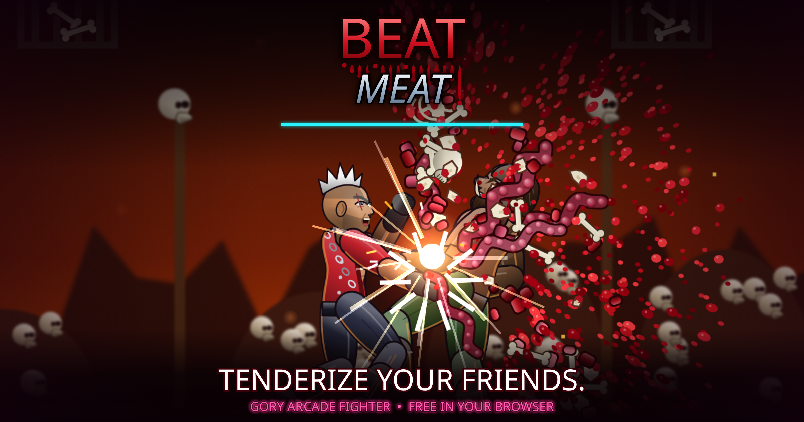

# Beat Meat: Tenderize Your Friends  (v13)

**A gory arcade fighter and co-op street brawler that you play free in your browser.**

### ▶ [PLAY NOW](https://0mrcrazy0.github.io/beatmeat/)

- **11 fighters, 6 buttons:** combos, specials, throws and bloody finishers.
- **Hidden FATALITIES:** when the announcer yells *FINISH THEM!*, enter the secret code.
- **Story mode for 1 or 2 players:** two street-brawling campaigns with six heroes who each play differently.
- **Play online with a friend:** Menu → ONLINE → host story co-op or versus, then send your friend the code or the invite link (`https://0mrcrazy0.github.io/beatmeat/?join=CODE`). Peer to peer, no account; versus uses rollback netcode.
- Arcade, Versus, Survival, Training and Tutorial modes. Works with a controller, a keyboard or touch.

## Controls: Versus

| Action | Xbox | Keyboard (P1) | Touch |
|---|---|---|---|
| Move / jump / crouch | Stick / D-pad | W A S D | Joystick |
| Light / Medium / Heavy Punch | X / Y / RB | U / I / O | LP / MP / HP |
| Light / Medium / Heavy Kick | A / B / RT | J / K / L | LK / MK / HK |
| Throw | LB | H | THROW |
| Story star move (story only) | LT | Space | STAR |
| Block | Hold away | Hold away | Hold away |
| Pause | MENU | Enter | II |

## Controls: Story

| Action | Xbox | Keyboard (P1) | Touch |
|---|---|---|---|
| Move | Stick / D-pad | W A S D | Joystick |
| Attack | X | U | ATTACK |
| Jump | A | J | JUMP |
| Special (costs a little health) | B | K | SPECIAL |
| Grab / pick up | Y | I | GRAB |
| Block | RB | O | BLOCK |
| Back attack | RT | L | BACK |
| Run | LB | H | RUN |
| Police call (once per stage) | LT | Space | CALL |

Player 2 can join at any time by pressing **START**. Every fighter's full move list is in the pause menu.

## Install on your phone

Open the play link, then tap **Share → Add to Home Screen** on iPhone, or **⋮ → Install app** on Android. After that it works offline.

---

**Created by MrCrazy**
